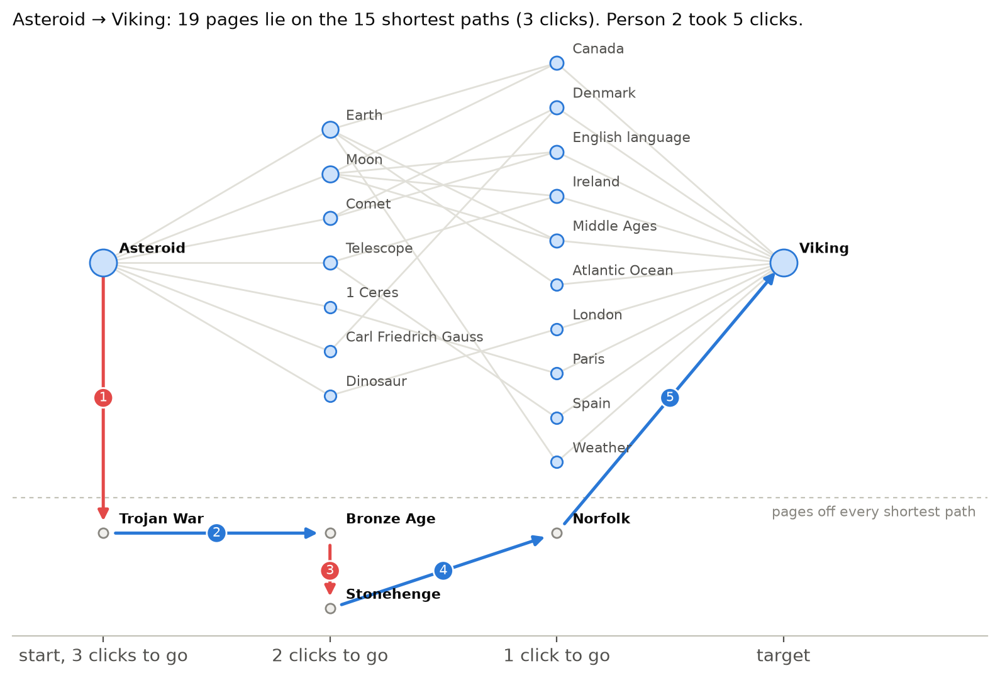
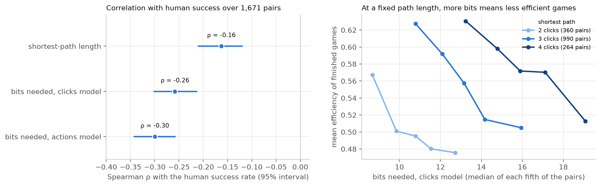

# Wiki game benchmark

In the Wikipedia game a player starts on one article and must reach another by clicking links, in as few clicks as
possible. This project turns the game into an agentic benchmark for language models. The agent reads the goal and
one part of the current page, then scrolls or clicks a link that it can see. Because the benchmark knows the whole
link graph, it scores every action exactly: how much closer it brought the agent, and how hard the choice was.

## The benchmark in short

- **World.** A frozen copy of 4,604 Wikipedia articles ([Wikispeedia](https://snap.stanford.edu/data/wikispeedia.html)),
  rendered to text and cut into chunks of about one screen. The dataset also holds about 76,000 games played by
  people.
- **Observation and actions.** The agent sees the goal and one chunk, with links written as `[anchor](Target page)`.
  It answers `click("Target page")`, `scroll_down()` or `scroll_up()`, and every action costs one step.
- **Best play.** Known exactly in two cost models: fewest *clicks* (the classic game, whole page visible) and fewest
  *actions* (one chunk visible, scrolls count). The two often prefer different routes.
- **Scores per step.** *Regret* counts the steps an action wasted. *Bits* measure how hard the choice was: the
  information a player needs to beat a random clicker at following an optimal path.

[docs/benchmark.md](docs/benchmark.md) defines the game, and [docs/metrics.md](docs/metrics.md) defines the scores
with a worked example.



## Results so far

**Does the bits measure track how hard a task is for people?** Tasks that need more bits should be harder for
people, and the measure is useful only if it says more than path length does. We took the 1,671 start–target pairs
that people played at least five times on Wikispeedia. For each pair we computed the shortest-path length and the
bits needed, then the share of people who finished and the efficiency of the finished games (optimal clicks ÷ clicks
taken).

Bits needed correlates more strongly with the human success rate than the shortest-path length does. Spearman's rank
correlation ρ is −0.30 for bits in the actions model and −0.26 in the clicks model, against −0.16 for path length.
The 95% bootstrap intervals over pairs are [−0.34, −0.26], [−0.30, −0.21] and [−0.21, −0.12]. Among pairs with the
same path length, more bits still means lower efficiency in finished games (ρ between −0.20 and −0.33 for path
lengths 2, 3 and 4).



*Provenance:* this repository, from the Wikispeedia logs. *Originality:* new measure, tested on an existing dataset.
*Strength:* retrospective analysis on one dataset. Details:
[notebooks/02_tasks_and_metrics.ipynb](notebooks/02_tasks_and_metrics.ipynb).

## Reading path

1. [docs/benchmark.md](docs/benchmark.md): the world, what the agent sees and does, and the two cost models.
2. [docs/metrics.md](docs/metrics.md): regret, efficiency and bits, with one human game scored step by step.
3. [docs/viewer.md](docs/viewer.md): the interactive task viewer, with screenshots.
4. [notebooks/01_build_world.ipynb](notebooks/01_build_world.ipynb) builds the world from Wikispeedia and checks
   the rendered links and distances against the dataset's own.
5. [notebooks/02_tasks_and_metrics.ipynb](notebooks/02_tasks_and_metrics.ipynb) defines the first task set, scores
   the human games and writes the files the viewer reads.
6. [wikigame/metrics.py](wikigame/metrics.py) holds the exact definitions; [wikigame/env.py](wikigame/env.py) is
   the environment an agent plays in.

## Where things are

| Path | What it holds |
|---|---|
| `docs/` | the documentation pages; `docs/figures/` holds their images |
| `wikigame/world.py` | HTML → text with link spans, chunking, loading a world |
| `wikigame/metrics.py` | cost to go, bits to go, optimal trajectory, scoring of trajectories |
| `wikigame/env.py` | text observation and action parsing for an LLM agent |
| `wikigame/style.py` | figure colours (shared with the viewer) and where figures are saved |
| `notebooks/01_build_world.ipynb` | builds the world, about 15 s after the download |
| `notebooks/02_tasks_and_metrics.ipynb` | task set, oracle, human baseline, about 40 s |
| `notebooks/03_figures_for_docs.ipynb` | the worked-example figures in `docs/`, about 5 s |
| `viewer/index.html` | the task viewer (plain HTML, no build step) |
| `data/raw/` | downloads, not in git |
| `data/worlds/<name>/` | generated world: `world.json`, `pages/<id>.json`, `tasks/<id>.json`, not in git |

Notebooks 01 and 02 also save their figures to `docs/figures/`. The viewer screenshots were taken from the running
viewer.

## Running

```bash
uv sync
uv run jupyter nbconvert --to notebook --execute --inplace notebooks/01_build_world.ipynb   # downloads ~800 MB once
uv run jupyter nbconvert --to notebook --execute --inplace notebooks/02_tasks_and_metrics.ipynb
uv run jupyter nbconvert --to notebook --execute --inplace notebooks/03_figures_for_docs.ipynb
uv run python -m http.server 8000        # then open http://localhost:8000/viewer/
```

[docs/benchmark.md](docs/benchmark.md#playing-a-task-from-python) shows how to play a task from Python.

## Open questions

- The step budget per task and how a game that runs out of steps is scored.
- Whether bits should also charge wasted steps, for example by measuring them against the remaining step budget
  ([docs/metrics.md](docs/metrics.md#regret-and-bits-measure-different-things) explains why they do not now).
- Running the first LLM agents, several runs per task, and comparing them with the human games.
- A larger world (Simple or full English Wikipedia from the Wikimedia HTML dumps), where human baselines are absent.
