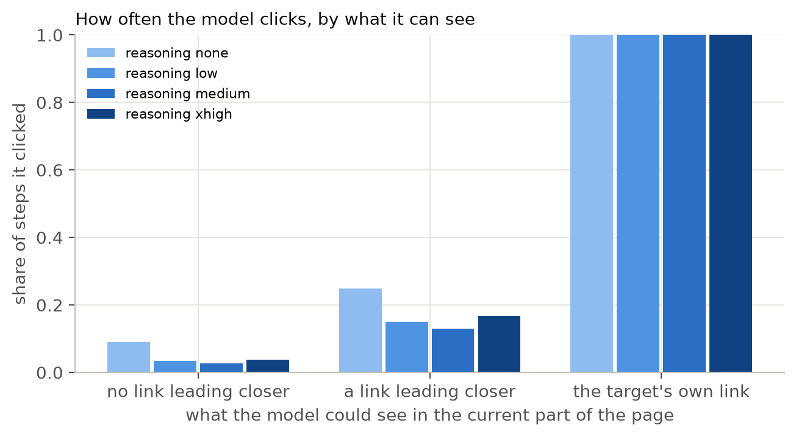

# Wiki game benchmark

In the Wikipedia game a player starts on one article and must reach another by clicking links, in as few clicks as
possible. This project turns the game into an agentic benchmark for language models. The agent reads the goal and
one part of the current page, then scrolls or clicks a link that it can see. Because the benchmark knows the whole
link graph, it scores every action exactly: how much closer it brought the agent, and how hard the choice was.

## The benchmark in short

- **World.** A frozen copy of 4,604 Wikipedia articles ([Wikispeedia](https://snap.stanford.edu/data/wikispeedia.html)),
  rendered to text and cut into chunks of about one screen. The dataset also holds about 76,000 games played by
  people.
- **Observation and actions.** The agent sees the goal and one chunk, with links written as `[anchor](Target page)`.
  It answers `click("Target page")`, `scroll_down()` or `scroll_up()`, and every action costs one step.
- **Best play.** Known exactly in two cost models: fewest *clicks* (the classic game, whole page visible) and fewest
  *actions* (one chunk visible, scrolls count). The two often prefer different routes.
- **Scores per step.** *Regret* counts the steps an action wasted. *Bits* measure how hard the choice was: the
  information a player needs to beat a random clicker at following an optimal path.

[docs/benchmark.md](docs/benchmark.md) defines the game, and [docs/metrics.md](docs/metrics.md) defines the scores
with a worked example.


## Results so far

**Does the bits measure track how hard a task is for people?** Tasks that need more bits should be harder for
people, and the measure is useful only if it says more than path length does. We took the 1,671 start–target pairs
that people played at least five times on Wikispeedia. For each pair we computed the shortest-path length and the
bits needed, then the share of people who finished and the efficiency of the finished games (optimal clicks ÷ clicks
taken).

Bits needed correlates more strongly with the human success rate than the shortest-path length does. Spearman's rank
correlation ρ is −0.30 for bits in the actions model and −0.26 in the clicks model, against −0.16 for path length.
The 95% bootstrap intervals over pairs are [−0.34, −0.26], [−0.30, −0.21] and [−0.21, −0.12]. Among pairs with the
same path length, more bits still means lower efficiency in finished games (ρ between −0.20 and −0.33 for path
lengths 2, 3 and 4).


*Provenance:* this repository, from the Wikispeedia logs. *Originality:* new measure, tested on an existing dataset.
*Strength:* retrospective analysis on one dataset. Details:
[notebooks/02_tasks_and_metrics.ipynb](notebooks/02_tasks_and_metrics.ipynb).

**Can a mid-sized open model play the game, and does reasoning help?** This is the first model run on the
benchmark, so it tests whether the task set separates a model from chance and from people. Qwen3.8 27B played the
42 tasks 3 times each, seeing one part of a page at a time, at four reasoning levels (none, low, medium, xhigh).

It reaches the target in about a quarter of its games at every level. That is far above a random player (3%) and
far below people on Wikispeedia (70%), who saw whole pages and had no step limit. The model clicks the target's link
every time it sees it. When it sees only a link that leads closer, it clicks in 13–25% of steps and scrolls in
the rest. Its clicks there go closer more often than a random click would (68–81% against about 50%), so the
model can judge links and seldom commits to one. Reasoning before each action does not change success. The model
clicks less often with reasoning and picks slightly better links, and a game takes two to three times as long.
[docs/qwen3.8-27b_results.md](docs/qwen3.8-27b_results.md) gives the full report and its interpretation.



*Provenance:* this repository. *Originality:* new. *Strength:* one model on 42 tasks, 3 sampled runs per task and
level, one system prompt.

## Reading path

1. [docs/benchmark.md](docs/benchmark.md): the world, what the agent sees and does, and the two cost models.
2. [docs/metrics.md](docs/metrics.md): regret, efficiency and bits, with one human game scored step by step.
3. [docs/viewer.md](docs/viewer.md): the interactive task viewer, with screenshots.
4. [docs/qwen3.8-27b_results.md](docs/qwen3.8-27b_results.md): the first language model on the benchmark, at four
   reasoning levels.
5. [notebooks/01_build_world.ipynb](notebooks/01_build_world.ipynb) builds the world from Wikispeedia and checks
   the rendered links and distances against the dataset's own.
6. [notebooks/02_tasks_and_metrics.ipynb](notebooks/02_tasks_and_metrics.ipynb) defines the first task set, scores
   the human games and writes the files the viewer reads.
7. [notebooks/04_run_llm_agent.ipynb](notebooks/04_run_llm_agent.ipynb) lets a language model play every task and
   saves the games; [notebooks/05_llm_agent_results.ipynb](notebooks/05_llm_agent_results.ipynb) scores them against
   the oracle, the random player and people.
8. [wikigame/metrics.py](wikigame/metrics.py) holds the exact definitions; [wikigame/env.py](wikigame/env.py) is
   the environment an agent plays in, and [wikigame/agent.py](wikigame/agent.py) plays it through a chat API.

## Where things are

| Path | What it holds |
|---|---|
| `docs/` | the documentation pages; `docs/figures/` holds their images |
| `wikigame/world.py` | HTML → text with link spans, chunking, loading a world |
| `wikigame/metrics.py` | cost to go, bits to go, optimal trajectory, scoring of trajectories |
| `wikigame/env.py` | text observation and action parsing for an LLM agent |
| `wikigame/agent.py` | the language-model player (any OpenAI-compatible chat API) and the random player |
| `wikigame/style.py` | figure colours (shared with the viewer) and where figures are saved |
| `notebooks/01_build_world.ipynb` | builds the world, about 15 s after the download |
| `notebooks/02_tasks_and_metrics.ipynb` | task set, oracle, human baseline, about 40 s |
| `notebooks/03_figures_for_docs.ipynb` | the worked-example figures in `docs/`, about 5 s |
| `notebooks/04_run_llm_agent.ipynb` | plays one model at one reasoning level, 1–3 h per level for Qwen3.8 27B |
| `notebooks/05_llm_agent_results.ipynb` | scores the saved games and draws the model figures, about 20 s |
| `results/<model>/effort-<level>.jsonl` | every game a model played: actions, replies, tokens, time and scores |
| `viewer/index.html` | the task viewer (plain HTML, no build step) |
| `data/raw/` | downloads, not in git |
| `data/worlds/<name>/` | generated world: `world.json`, `pages/<id>.json`, `tasks/<id>.json`, not in git |

Notebooks 01, 02 and 05 also save their figures to `docs/figures/`. The viewer screenshots were taken from the running
viewer.

## Running

```bash
uv sync
uv run jupyter nbconvert --to notebook --execute --inplace notebooks/01_build_world.ipynb   # downloads ~800 MB once
uv run jupyter nbconvert --to notebook --execute --inplace notebooks/02_tasks_and_metrics.ipynb
uv run jupyter nbconvert --to notebook --execute --inplace notebooks/03_figures_for_docs.ipynb
uv run python -m http.server 8000        # then open http://localhost:8000/viewer/

# a language model: point to any OpenAI-compatible chat API, one run per reasoning level
export LLM_BASE_URL=http://host:port/v1 LLM_API_KEY=...
REASONING_EFFORT=none uv run jupyter nbconvert --to notebook --execute --inplace notebooks/04_run_llm_agent.ipynb
uv run jupyter nbconvert --to notebook --execute --inplace notebooks/05_llm_agent_results.ipynb
```

Notebook 04 sets the model name at its top. An interrupted run can be started again: it skips the games already
saved.

[docs/benchmark.md](docs/benchmark.md#playing-a-task-from-python) shows how to play a task from Python.

## Open questions

- The step budget per task and how a game that runs out of steps is scored.
- Whether bits should also charge wasted steps, for example by measuring them against the remaining step budget
  ([docs/metrics.md](docs/metrics.md#regret-and-bits-measure-different-things) explains why they do not now).
- Whether a prompt with strategy, a whole-page view or a larger step budget would make the model commit to
  intermediate pages ([docs/qwen3.8-27b_results.md](docs/qwen3.8-27b_results.md#what-to-try-next)).
- More models, including stronger ones, to see whether the task set spreads them out.
- A larger world (Simple or full English Wikipedia from the Wikimedia HTML dumps), where human baselines are absent.
