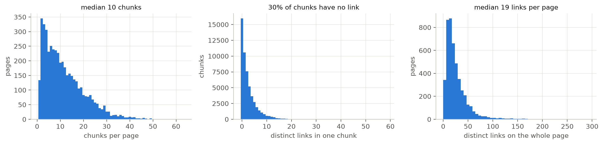
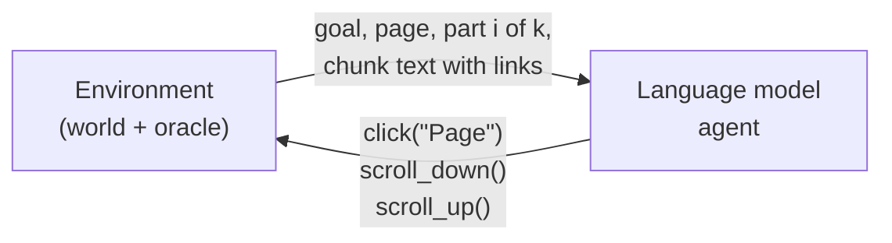
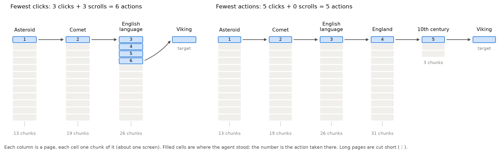

# The benchmark

This page defines the game an agent plays: the world, what the agent sees, what it may do, and what counts as the
best possible play. [How a game is scored](metrics.md) builds on it.

## Why this game

In the Wikipedia game a player starts on one article and must reach another by clicking links. People know the
game, and its goal needs no judge. Playing it well takes two skills that language models are often tested on
separately. The first is world knowledge: guessing which article is likely to mention the target. The second is
planning over several steps with partial information. Because the whole link graph is known in advance, the best
possible play is known exactly. So every single action can be scored. A benchmark that only checks whether the
agent arrived would waste that.

## The world

The world is a frozen set of articles, so that the best play never changes under the agent. The first world is
[Wikispeedia](https://snap.stanford.edu/data/wikispeedia.html) (West and Leskovec). It holds 4,604 articles from
the 2007 *Wikipedia for Schools* selection, with about 120,000 links. It also logs about 76,000 games of this task
played by people, which gives a human baseline from the start.

Each article is turned into plain text. Headings, list items, table rows and image captions are kept. Scripts,
reference markers and the site banner are dropped. A link is kept only if it points to one of the 4,604 articles,
because no other page exists in this world. Links that point back to the same article are dropped, since following
one does not move the player. Links whose only anchor is an image (a flag that links to *Flag of Mexico*) are also
dropped, because a text-only agent cannot see them.

The text is then cut into **chunks** of at most 2,000 characters, about one screen or 450 tokens. Cuts fall on a
line break when possible, then at the end of a sentence, then at a space, and never inside a link.



*A typical page spans 10 screens, and almost a third of all screens hold no link at all, so scrolling matters.
Left: chunks per page. Middle: distinct links visible in one chunk. Right: distinct links on a whole page.*

The world has 4,604 pages and 53,697 (page, chunk) states. 17 pages have no outgoing link and 469 cannot be
reached from any other page. [notebooks/01_build_world.ipynb](../notebooks/01_build_world.ipynb) builds the world
and checks it against the dataset's own link list and distance matrix.

## One episode

The agent and the environment take turns. The environment shows the goal and one chunk of the current page. The
agent answers with one action, and the environment shows the result.



This is the first observation of the task *Asteroid* → *Viking*, cut after a few lines. Every link is written as
`[anchor text](Target page)`, so the agent knows where a link goes before it clicks:

```text
Goal: reach the Wikipedia page "Viking" by following links, in as few actions as possible.
You are on "Asteroid", part 1 of 13 (scroll down for more).
Actions used: 0 of 30.
-----
253 Mathilde, a C-type asteroid.

Asteroids, also called minor planets or planetoids, are a class of astronomical object. The term asteroid is
generally used to indicate a diverse group of small celestial bodies that drift in the [solar system](Solar System)
in orbit around the [Sun](Sun). … which includes most objects thusfar classified as minor planets, as well as
[comets](Comet). …
-----
Reply with one action: click("Page name") for a link shown above, scroll_down(), or scroll_up().
```

The rules:

- **Actions.** `click("Target page")` follows a link that is visible in the current chunk and lands on the first
  chunk of that page. `scroll_down()` and `scroll_up()` move one chunk within the page.
- **Cost.** Every action costs one step. An invalid action (a link that is not in view, scrolling past the end, or a
  reply with no action) also costs one step and leaves the agent where it was, with a short error message.
- **End.** The episode ends when the agent reaches the target page, whatever chunk, or when it runs out of steps.
  The step budget is still open.

## Two cost models

The same game can be scored in two ways, and they answer different questions.

- **Clicks model**, the classic game. The player sees the whole page and only clicks count. The best play is a
  shortest path in the graph of pages. Its length is written *d\**. This is the model for the human games, because
  people saw whole pages.
- **Actions model**, the agentic benchmark. The player sees one chunk at a time, and scrolls count as steps too. The
  best play is a shortest path in the graph whose nodes are (page, chunk) states. A click links a chunk to the first
  chunk of another page, and a scroll links neighbouring chunks of one page. Its length is written *V\**.

The two models can prefer different routes, because a short route in clicks may hide its links deep down the page.



*From* Asteroid *to* Viking *the fewest clicks is 3. That route needs 3 scrolls on* English language *to reach the
link, so it takes 6 actions. A route with 5 clicks and no scroll takes only 5 actions. (Another route, with 4 clicks
and 1 scroll, ties with it.)*

The gap can be much larger. From *Smog* to *Toy Story* the fewest clicks is 5, and the best route with 5 clicks takes
30 actions, because the only good links sit far down long pages. A route with 7 clicks and 18 scrolls takes 25.
Over the 1,671 start–target pairs that people played at least five times, the median *d\** is 3 clicks and the
median *V\** is 5 actions.

## The task set

The first task set has 42 (start, target) pairs. For each *d\** from 1 to 6 it takes the pairs people played most,
with at least 10 games and up to 8 pairs per distance. People rarely played long tasks, so 6 random pairs with *d\**
from 5 to 7 are added, chosen with a fixed seed. Those have no human baseline.
[notebooks/02_tasks_and_metrics.ipynb](../notebooks/02_tasks_and_metrics.ipynb) builds the set and writes one file
per task with everything the scorer and the [viewer](viewer.md) need.

## Playing a task from Python

```python
from wikigame.world import World
from wikigame.metrics import Graphs, Oracle
from wikigame.env import WikiGameEnv

world = World.load("wikispeedia")
oracle = Oracle(world, Graphs.build(world), target=world.index["Viking"])
env = WikiGameEnv(world, oracle, start=world.index["Asteroid"], max_steps=30)
print(env.observe())                 # the prompt for the model
obs, done = env.step('click("Comet")')
env.score()                          # actions-model and clicks-model summaries
```

The environment reads the first action it finds in the reply, so a model may think aloud before it answers.
