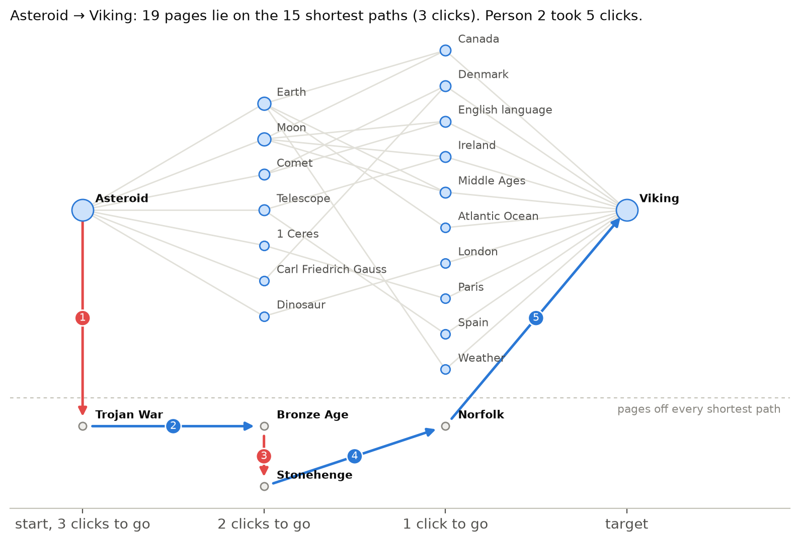
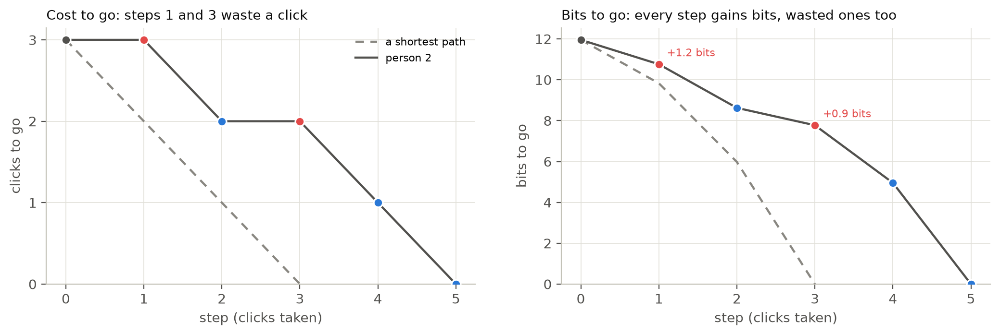

# How a game is scored

Whether the agent arrived, and in how many steps, says little about *where* it went wrong. Because the benchmark
knows the whole graph, it can score every single action. It asks two questions of each action: did it bring the
agent closer to the target, and how hard was the choice it made. This page defines the measures behind each
question, with a worked example. The states and the two cost models are defined in
[The benchmark](benchmark.md). The exact code is in [wikigame/metrics.py](../wikigame/metrics.py).

Every measure below exists in both cost models. In the clicks model a state is a page and an action is a click. In
the actions model a state is a (page, chunk) pair and an action is a click or a scroll.

## Did the action bring the agent closer?

The **cost to go** of a state is the fewest steps from there to the target. It is found by breadth-first search
backwards from the target, once per target, in about 35 ms for all 53,697 states.

The **regret** of a step is the number of steps it wasted:

$$\text{regret} = 1 + \text{cost to go after} - \text{cost to go before}$$

An optimal step lowers the cost to go by one, so its regret is 0. A step that leaves the cost unchanged has regret 1,
and a step that moves away has regret 2. Over a game that reaches the target, the regrets add up to the steps taken
minus the optimal number of steps. Two game-level scores follow:

- **efficiency** = optimal steps ÷ steps taken, which is 1 for perfect play and 0 for a game that never arrives;
- **first error**, the step at which regret first appears.

## How hard was the choice?

Some optimal steps are easy: a page may offer many links that lead closer. Others are hard, with one good link among
fifty. To measure this, the benchmark compares the agent with a reference player who knows nothing and picks
uniformly at random among the actions available.

Let *P(x)* be the probability that this random player, starting from state *x*, follows an optimal path all the
way to the target. It can be computed backwards from the target:

$$P(x) = \frac{1}{n(x)} \sum_{a \,\in\, \text{optimal}(x)} P\big(\text{next}(x, a)\big), \qquad P(\text{target}) = 1,$$

where *n(x)* is the number of actions available in *x*, optimal(*x*) is the set of actions that lower the cost to go
by one, and next(*x*, *a*) is the state that action *a* leads to. The **bits to go** of a state turn this
probability into a count of yes/no decisions:

$$\varphi(x) = -\log_2 P(x)$$

It is the information a player must supply to play optimally from *x*. The **bits needed** for a task are
*φ(start)*, and they measure how hard the task is. For example, *Asteroid* → *Viking* needs 12.0 bits in the clicks
model: a random clicker follows one of the 15 shortest paths with probability 2⁻¹², about 1 in 4,000.

**Worked example.** On the first chunk of *Asteroid*, the agent has 8 actions: 7 links and a scroll. In the actions
model only the click on *Comet* is optimal, and from the first chunk of *Comet* the bits to go are 11.87. So

$$\varphi(\text{Asteroid, part 1}) = -\log_2\left(\tfrac{1}{8} \cdot 2^{-11.87}\right) = 3 + 11.87 = 14.87 \text{ bits.}$$

The 3 bits are the price of picking 1 good action out of 8.

The **information gain** of a step from *x* to *y* is *φ(x) − φ(y)*. When *k* of the *n* actions are optimal and
lead to equally hard states, an optimal step gains log₂(*n*/*k*) bits, the *chance bits* of that choice. Because the
gains telescope, they add up to *φ(start)* over any game that reaches the target, whatever route it took. The
**bits lost** of a game are the sum of its negative gains.

## Regret and bits measure different things

A step that wastes a click can still *gain* bits. The figure shows why, with a real game from the Wikispeedia logs.

*Every page on a shortest path from* Asteroid *to* Viking*, placed by its distance to the target and sized by the
number of shortest paths through it. On top is the game of person 2 in the viewer. Red steps have regret: they did
not bring the person closer. Pages the person visited off every shortest path sit in the band below.*

The person went *Asteroid* → *Trojan War* → *Bronze Age* → *Stonehenge* → *Norfolk* → *Viking*. That is 5 clicks
where 3 suffice, so the efficiency is 0.60. Steps 1 and 3 each wasted a click.

*Cost to go and bits to go after each step of the same game, with one shortest path dashed for comparison. Clicks
to go stays flat on the wasted steps (red), and bits to go still falls.*

Both wasted steps gain bits: 1.2 and 0.9. *Trojan War* is three clicks from *Viking*, like *Asteroid*. However, 25 of
its 41 links lead closer (61%), against 7 of 19 on *Asteroid* (37%). So a random clicker is more likely to play optimally
from *Trojan War*, and its bits to go are lower. A page with many good links (a *hub*) lowers the bits to go even
when the target is no nearer. This game therefore loses 0 bits despite its 2 wasted clicks. In the current
definition, regret is the signal for a wasted step, and bits measure how much easier the remaining choice became.

Whether wasted steps should also cost bits is still open. One option is to measure *φ* against the remaining step
budget, so that a step that does not get closer always loses probability.

## Per-game summary

| Score | Meaning |
|---|---|
| reached the target | yes or no |
| steps taken, optimal steps | in the chosen cost model |
| efficiency | optimal steps ÷ steps taken, 0 if the target was not reached |
| steps with regret, first error | how many steps wasted at least one step, and the first of them |
| bits needed | *φ(start)*, fixed by the task |
| bits lost | sum of the negative information gains |

An agent's game is scored in both models: the actions model scores what it actually did, and the clicks model scores
the pages it visited, which makes it comparable with people. Human games are scored in the clicks model only, since
people saw whole pages.
