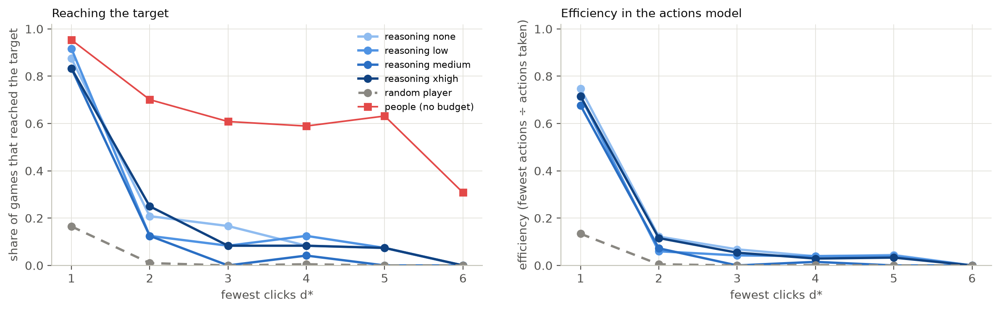
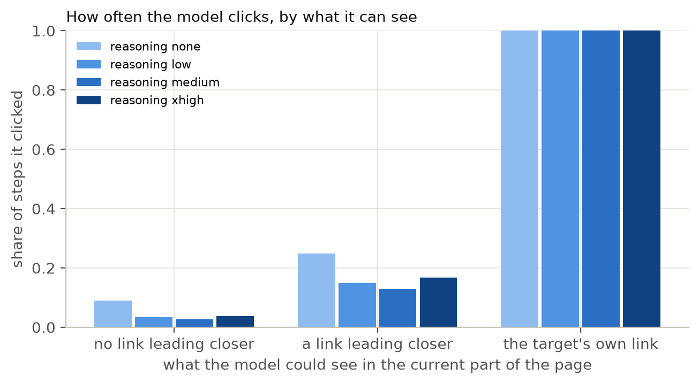
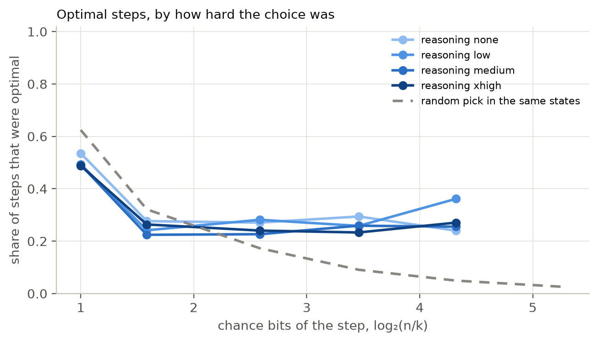

# Qwen3.8 27B on the first task set

This report describes the first language model that played the benchmark, Qwen3.8 27B, at four reasoning levels. It
answers three questions. Can a mid-sized open model play the game? Why does it lose when it loses? Does letting it
reason before each action help? A last section says what the results mean for the model and for the benchmark.

[benchmark.md](benchmark.md) describes the game, and [metrics.md](metrics.md) describes the scores. Every number
here comes from [notebooks/05_llm_agent_results.ipynb](../notebooks/05_llm_agent_results.ipynb), which scores the
games saved in `results/qwen3.8-27b/`.

## How the model played

The model played the 42 tasks of the [first task set](benchmark.md#the-task-set) through a chat API. Each turn it
received the goal and one part of the current page, about one screen of text, and replied with one action:
`click("Page")`, `scroll_down()` or `scroll_up()`. The whole game so far stayed in its context. The system prompt
states only the rules; it gives no advice on strategy ([wikigame/agent.py](../wikigame/agent.py) holds it).

Each task was played 3 times with sampling (temperature 0.7), with a different seed per run, because one game per
task would mix skill with luck. Every number below is the mean over the 3 runs. Brackets give the lowest and
highest of the 3 per-run means, where each run covers all 42 tasks once. A game ends when the model reaches the
target or uses up its step budget of 2·V\* + 10 actions. V\* is the fewest actions the task needs when scrolls
count as steps (the *actions model*). The budget is 22 actions for the median task.

The whole run was repeated at four reasoning levels: none, low, medium and xhigh. The level sets how much hidden
reasoning the model writes before each reply. Without reasoning it wrote about 10 tokens per step. With reasoning it
wrote 213, 222 and 355 tokens per step at low, medium and xhigh.

Two references frame the numbers. The *random player* picks uniformly among the available actions with the same
step budget, 50 games per task; it shows what zero skill scores. *People* are the Wikispeedia players of the same
tasks. They saw whole pages and had no step budget, so their success rate is an upper reference. Six long tasks were
never played by people, which leaves 36 tasks with a human baseline.

## Can the model play the game?

It reaches the target in about a quarter of its games, whatever the reasoning level. That is far above the random
player (3%) and far below people, who finished 70% of the tasks they played.

| Reasoning level | Reached the target | Efficiency | Clicks per game | Scrolls per game | Minutes per game |
|---|---|---|---|---|---|
| none | 0.27 [0.19–0.33] | 0.20 [0.13–0.25] | 3.2 | 17.5 | 3.5 |
| low | 0.25 [0.21–0.29] | 0.17 [0.15–0.19] | 1.7 | 19.3 | 6.6 |
| medium | 0.19 [0.17–0.24] | 0.15 [0.13–0.17] | 1.3 | 20.1 | 6.7 |
| xhigh | 0.25 [0.21–0.31] | 0.18 [0.17–0.20] | 1.8 | 19.0 | 10.4 |
| random player | 0.03 | 0.03 | 18.7 | 4.7 | – |

*Efficiency* is the fewest actions ÷ actions taken, counted as 0 for a game that did not arrive. It rewards
arriving and arriving fast.

Success depends almost entirely on whether one click is enough. When the target is linked from the start page (the
fewest clicks *d\** is 1), the model arrives in 83–92% of its games. When the task needs two clicks or more, it
arrives in at most a quarter of its games at any level, and in none of the games that need six. People lose much
less with distance: they finish 70% of the two-click tasks and about 60% of the tasks that need three to five.

## Why does the model lose?

Every lost game ran out of steps, and in almost all of them more than half of the steps were scrolls. Between 18%
and 27% of all games ended without a single click. Scrolling can be sensible, because the start pages are long: the
median start page has 17 parts, and only 17% of its parts show a link to a page closer to the target. Half the tasks
do show such a link in the first part, however. So the question is whether the model scrolls because nothing useful
is in view, or scrolls past useful links.

To answer it, we labelled each state the model was in by what it could see. A state shows *the target's own link*, a
*link leading closer* (to a page one click closer to the target), or *no link leading closer*. For each kind of
state we measured how often the model clicked.

The model clicks the target's link every time it sees it, in all 122 such states. When only a link leading closer is
in view, it clicks in 13–25% of the steps and scrolls in the rest. These states are common: they make up 26–31%
of all the states the model was in. On average about half of the links in view in them lead closer, so a random
click there would have made progress half the time.

When the model does click in those states, its choice is good. Between 68% and 81% of its clicks went to a closer
page, against 49–54% for a random click among the same links. The same holds over all steps. On steps where a random
pick of action is optimal less than 10% of the time, the model's action is optimal about a quarter of the time.

The model loses because it rarely commits to an intermediate page. It can tell which links lead closer, better than
chance, and it acts at once when the target itself is in view. Otherwise it keeps reading, as if it were searching
the page for the target's name. In 36–46% of its games it read the whole start page before its first click, or never
clicked. Reading a 17-part page uses most of a 22-step budget.

## Does reasoning help?

Reasoning does not raise success. For each task we took the success over its 3 runs at one level minus the success
without reasoning, then averaged over the 42 tasks. The 95% bootstrap interval resamples the tasks 10,000 times.

| Level | Tasks better | Tasks worse | Mean change in success |
|---|---|---|---|
| low | 5 | 7 | −0.016 [−0.095, +0.063] |
| medium | 4 | 11 | −0.079 [−0.159, −0.008] |
| xhigh | 7 | 9 | −0.016 [−0.087, +0.056] |

Low and xhigh are indistinguishable from no reasoning. Medium is slightly worse. Its interval only just excludes
zero, and it is one of three comparisons, so it is weak evidence of harm.

Reasoning changes how the model plays without changing the outcome. It makes the first click earlier: at step 2.5 to
4.5 (the median over games) against step 8 without reasoning. After that it hesitates more. With a link leading
closer in view, it clicks in 13–17% of steps against 25% without reasoning, and it ends with about half as many
clicks per game. The clicks it makes are slightly better: 74–81% of them go to a closer page, against 68% without
reasoning. The two changes cancel.

Reasoning costs time. A game took 3.5 min without reasoning, 6.6–6.7 min at low and medium, and 10.4 min at xhigh.
The full runs of 126 games took 57, 115, 115 and 180 minutes, with 8 games played in parallel against one model
server. Most of the time is spent reading the prompt, which grows to about 10,000 tokens late in a game because the
whole game stays in context.

## What the results mean

**For the model.** Qwen3.8 27B plays the game by recognition. It clicks at once when it sees the target, and it
judges which links lead closer better than chance. It seldom acts on that judgement, so it spends its steps reading.
Thinking longer before each action does not change this policy. The limit lies in when the model decides to leave a
page, which is a question of strategy over the whole game. The quality of each single decision is already above
chance.

**For the benchmark.** Showing one part of a page at a time turns the game into a test of exploration against
commitment. A player must decide whether to take a good link now or keep reading in the hope of a better one. The
classic game, with the whole page in view, hides this choice. The task set spreads the model's games over a wide
range. The one-click tasks are solved, the tasks of two clicks and more are mostly lost, and people show the room
above. The bits measure also separates skill from chance at the level of single steps, which the success rate alone
cannot.

**Limitations.** This is one model, run 3 times on 42 tasks, with one system prompt that gives no strategy. People
saw whole pages, so part of the gap to them comes from the interface. The step budget is a design choice: a player
that reads every page to the end cannot finish within it, and a larger budget might let the model arrive more
often. The runs did not save the reasoning text, so its content cannot be inspected.

## What to try next

- A prompt that says that clicking an intermediate page is allowed and often best. This tests whether the
  hesitation follows from the instructions or from the model.
- An observation with the whole page in view, the same interface people had. This measures how much of the gap to
  people the one-part view explains.
- A larger step budget, to see whether the model would arrive with more time or keeps reading.
- Saving the reasoning text, to read what the model weighs before it scrolls past a good link.
- Other models, to see how far the task set spreads them.

## Reproducing

[notebooks/04_run_llm_agent.ipynb](../notebooks/04_run_llm_agent.ipynb) plays one reasoning level and saves each game
to `results/qwen3.8-27b/effort-<level>.jsonl`. It took 1–3 hours per level against a homelab server. A game that
fails on a server error is skipped and played on the next run of the notebook. Two games (one at low, one at
xhigh) were replayed this way after the gateway returned 502 errors.
[notebooks/05_llm_agent_results.ipynb](../notebooks/05_llm_agent_results.ipynb) scores all saved games in about
20 seconds.
