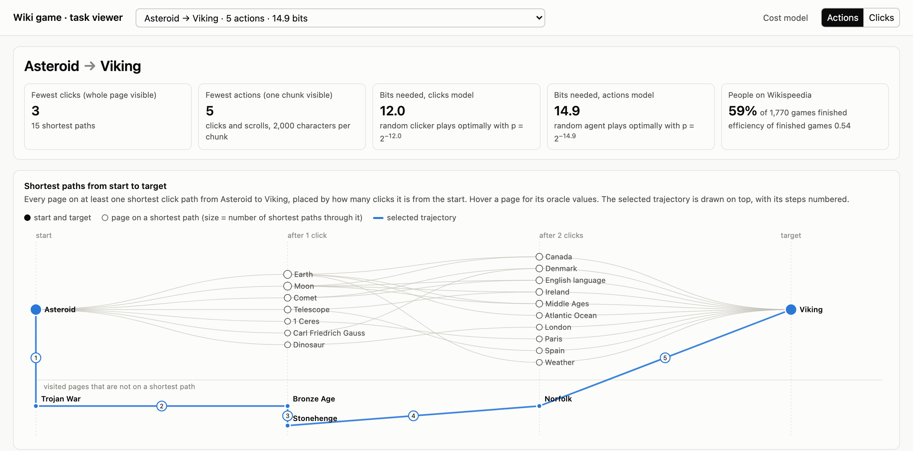
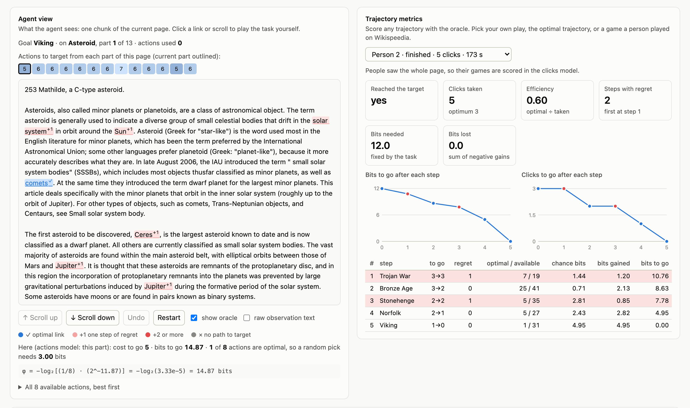

# The task viewer

The viewer shows one task at a time: the graph of its shortest paths, the page as the agent sees it, and the
step-by-step scores of any game on it. It exists to check the oracle by eye and to see where a player went wrong.
It is one HTML file, [viewer/index.html](../viewer/index.html), with no build step.

## Running it

The viewer reads the world and the task files, which are generated and not in git. Build them once, then serve the
repository folder:

```bash
uv sync
uv run jupyter nbconvert --to notebook --execute --inplace notebooks/01_build_world.ipynb   # downloads ~800 MB once
uv run jupyter nbconvert --to notebook --execute --inplace notebooks/02_tasks_and_metrics.ipynb
uv run python -m http.server 8000        # then open http://localhost:8000/viewer/
```

The link `http://localhost:8000/viewer/#task=363-4364` opens a given task directly (start page id, then target
page id).

## Task overview and graph



The header picks the task and the cost model (actions or clicks). The tiles give the task's numbers: the fewest
clicks and the number of shortest paths, the fewest actions, the bits needed in each model, and how people did on
Wikispeedia.

The graph shows every page on a shortest click path from start to target, by the number of clicks from the start. A
page's size is the number of shortest paths through it. The selected game is drawn on top with numbered steps.
Pages it visited off every shortest path sit in the band below the line. Hovering a page shows its oracle values.

## Agent view and trajectory scores



**Agent view (left).** The chunk the agent sees. Clicking a link or a scroll button plays the task; *Undo* and
*Restart* step back. The row of numbered boxes is the page's chunks, each with its cost to go, and the current one is
outlined. With *show oracle* on, each link is marked: ✓ for an optimal link, +1 or +2 for the steps it would waste,
× when no path leads from it to the target. Below the text, the viewer writes out how the bits to go of the current
state are computed, and a table lists every available action with its cost to go, regret and bits. *Raw observation
text* shows the exact prompt a language model would receive.

**Trajectory metrics (right).** Scores one game: your own play, the optimal trajectory, or any of the first 60
human games on the task. The tiles give the game's summary scores. The charts show bits to go and steps to go after
each step, with red dots on steps with regret. The table lists every step. Here, person 2 took 5 clicks where 3
suffice, with regret at steps 1 and 3. [How a game is scored](metrics.md) explains this game step by step.
